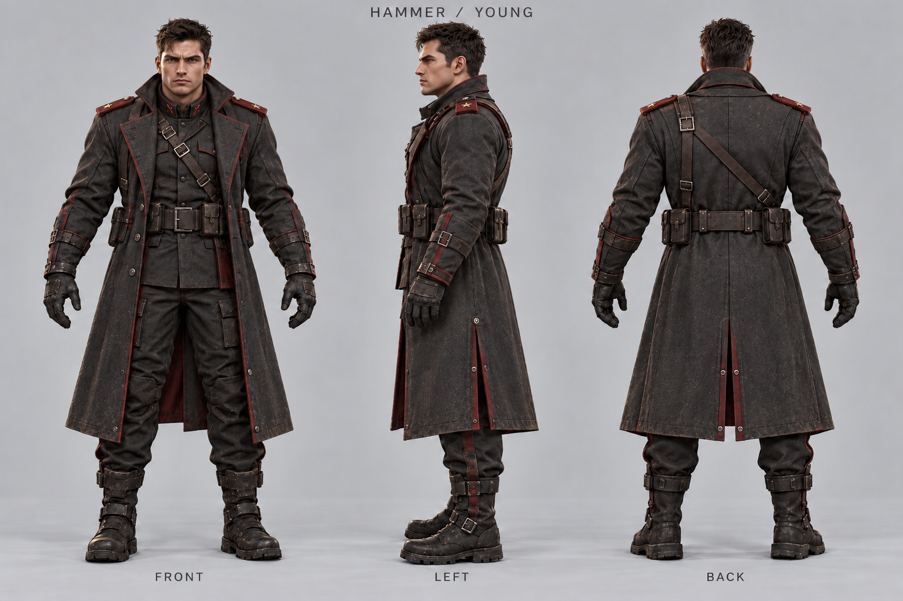
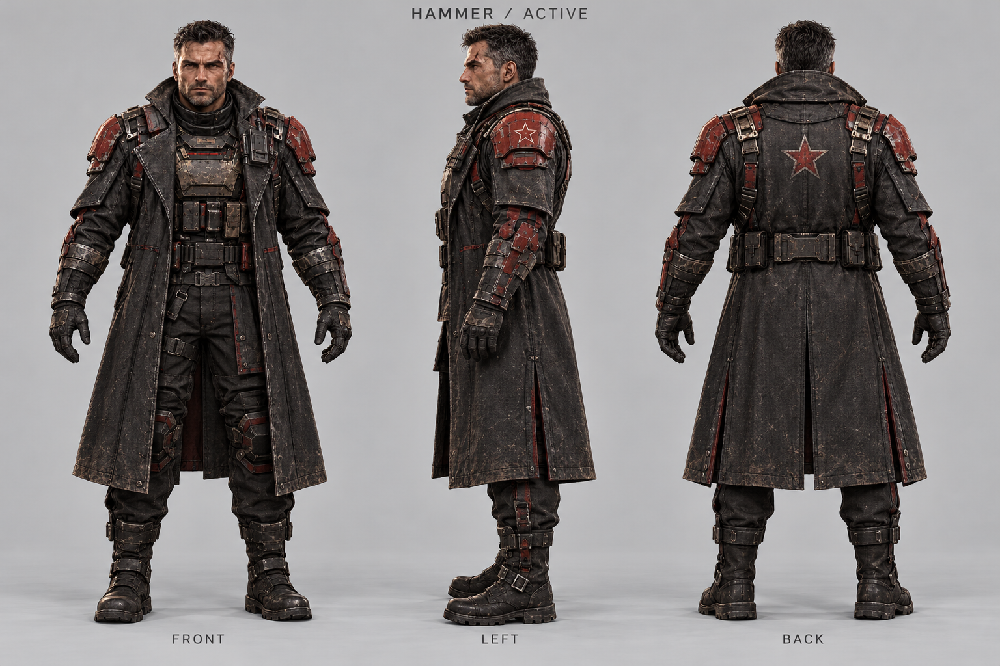
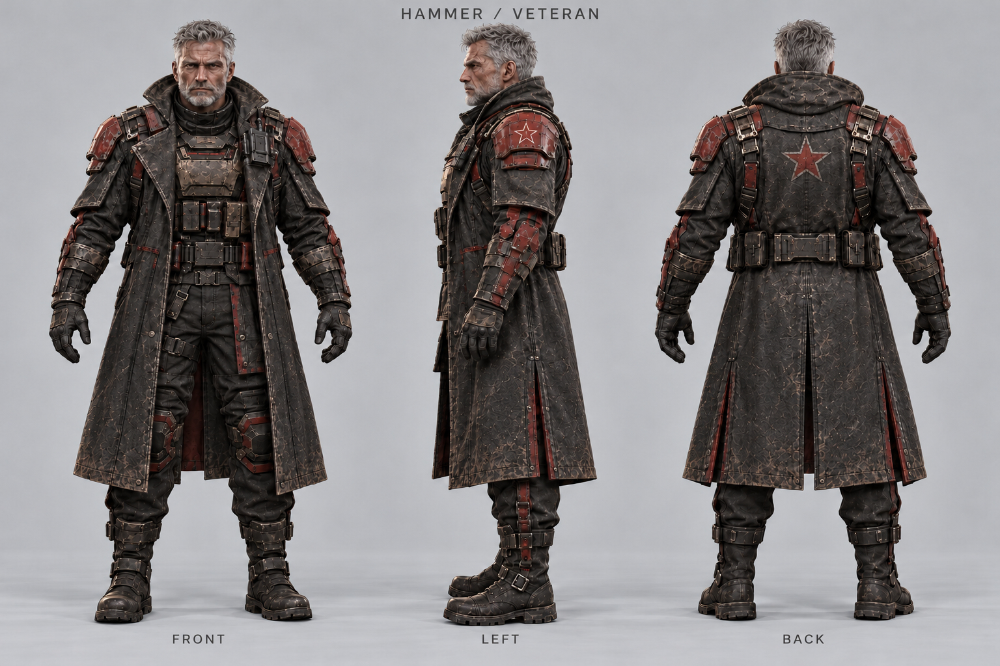
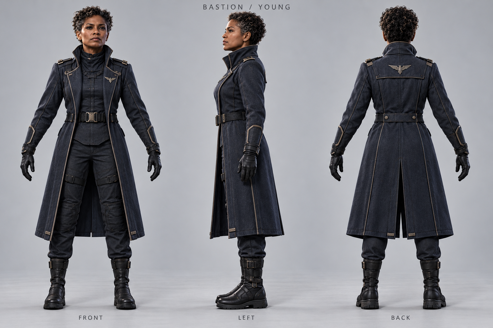
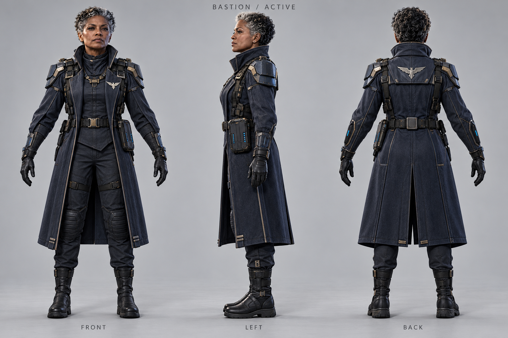
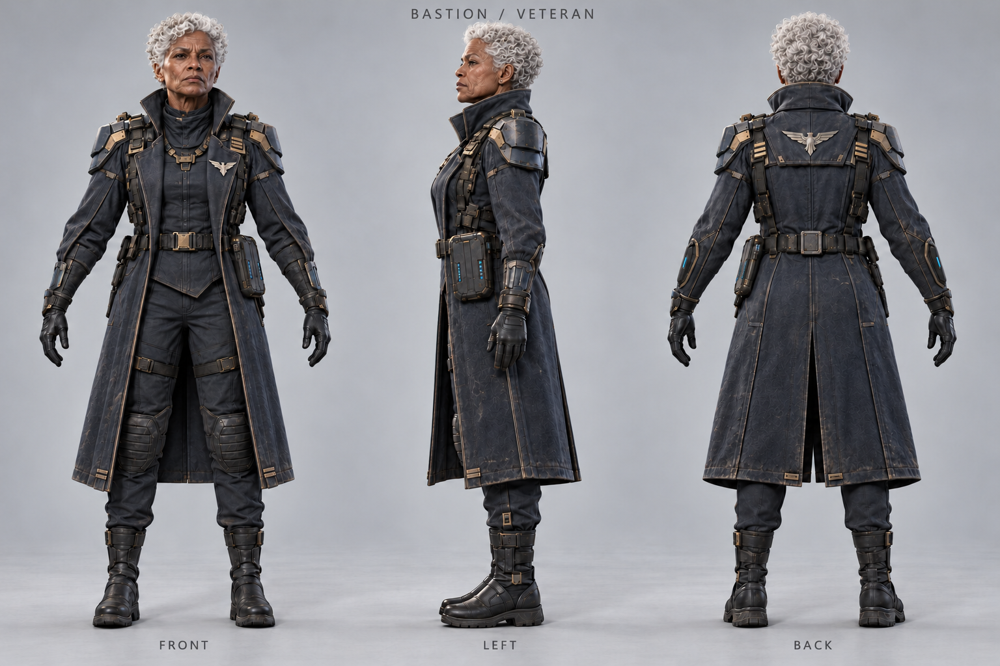
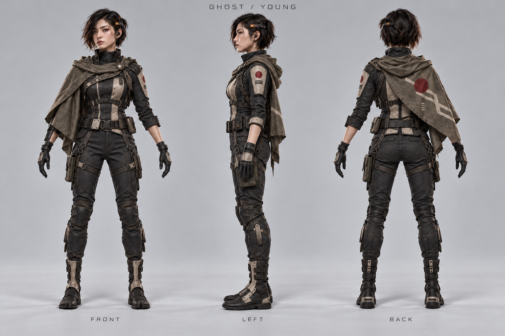
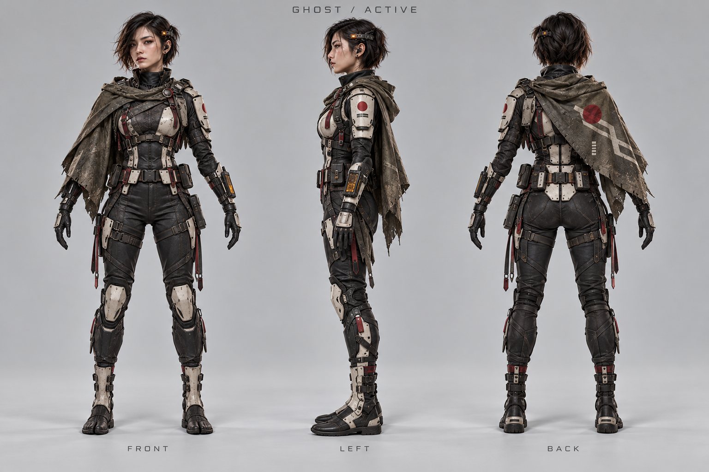
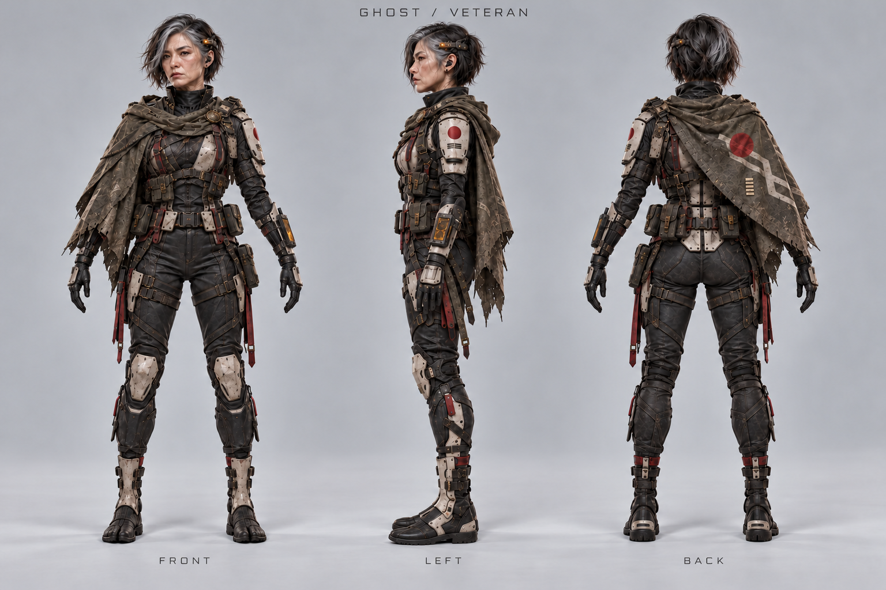

# 三时期人物三视图 v1

本轮为三位指挥官制作青年军官、现役指挥官、资深指挥官三个时期的视觉草案，供角色审阅和后续视频参考。时期标签表达外形发展方向，不规定精确年龄，也不是剧情定稿。

人物身份以 [Remix-AI 故事蓝本](story-bible.md) 为准：三人原本是职业军人，植入 AI 算力芯片后成为辅助判断型融合体。三视图继续保持 `visual_draft` 状态。“青年＝植入前、现役＝融合初期、资深＝长期融合”只是待确认的剧情对应建议，不能据此认定人物履历或植入时间。

每张图的目标视图顺序从左到右为 **front / left / back（正面 / 左侧 / 背面）**。生成图用于概念设计与身份一致性参考，不保证完全工程正交；制作视频前应检查侧背视图、服装和脸部的一致性。

当前九张 PNG 的文件头实测均为 **1536 × 1024**。提示词中的目标分辨率是生成期望，并非实际交付尺寸。

原始概念图 `source.png` 与早期视频保留在各人物目录中，本轮三视图另存于 `turnarounds/v1/`，不覆盖原图。提示词和后续修订记录见 [生成提示词](turnaround-prompts-v1.json)。

## 铁锤 / HAMMER · 苏联

维克托·莫罗佐夫 / Viktor Morozov

### 青年军官

[查看原尺寸 PNG](../assets/commanders/hammer/turnarounds/v1/young-r2.png)

### 现役指挥官

[查看原尺寸 PNG](../assets/commanders/hammer/turnarounds/v1/active.png)

### 资深指挥官

[查看原尺寸 PNG](../assets/commanders/hammer/turnarounds/v1/veteran-r2.png)

## 堡垒 / BASTION · 盟军

女性形象保留，正式姓名待定

### 青年军官

[查看原尺寸 PNG](../assets/commanders/bastion/turnarounds/v1/young.png)

### 现役指挥官

[查看原尺寸 PNG](../assets/commanders/bastion/turnarounds/v1/active.png)

### 资深指挥官

[查看原尺寸 PNG](../assets/commanders/bastion/turnarounds/v1/veteran-r2.png)

## 幽灵 / GHOST · 升阳

女性形象保留，正式姓名待定

### 青年军官

[查看原尺寸 PNG](../assets/commanders/ghost/turnarounds/v1/young.png)

### 现役指挥官

[查看原尺寸 PNG](../assets/commanders/ghost/turnarounds/v1/active.png)

### 资深指挥官

[查看原尺寸 PNG](../assets/commanders/ghost/turnarounds/v1/veteran-r2.png)

## 视频参考用法

先选定人物和时期，将对应三视图作为角色身份、体型和服装参考；实际镜头构图、动作、光线与场景在视频提示词中另行描述。必要时按镜头朝向选取对应视图，避免把三个人物面板误生成同框角色。跨时期制作时先人工核对脸部与标志性细节，确保仍是同一人物。

`catalog.json` 的 `turnarounds.periods` 提供各时期图片路径与实测尺寸，`index` 指向本文。版本修订时保留被替代文件并登记 `archived_images`，避免丢失生成记录。

## 生成与修订记录

本轮使用 Codex 内置 ImageGen；保留 [首轮提示词](turnaround-prompts-v1.json) 与 [年龄修订提示词](turnaround-refinement-prompts-v1.json)。四张年龄修订稿以 `-r2.png` 保存，首轮图保留并在 catalog 的 archived_images 中登记。本索引展示最终选用的九张草案。
